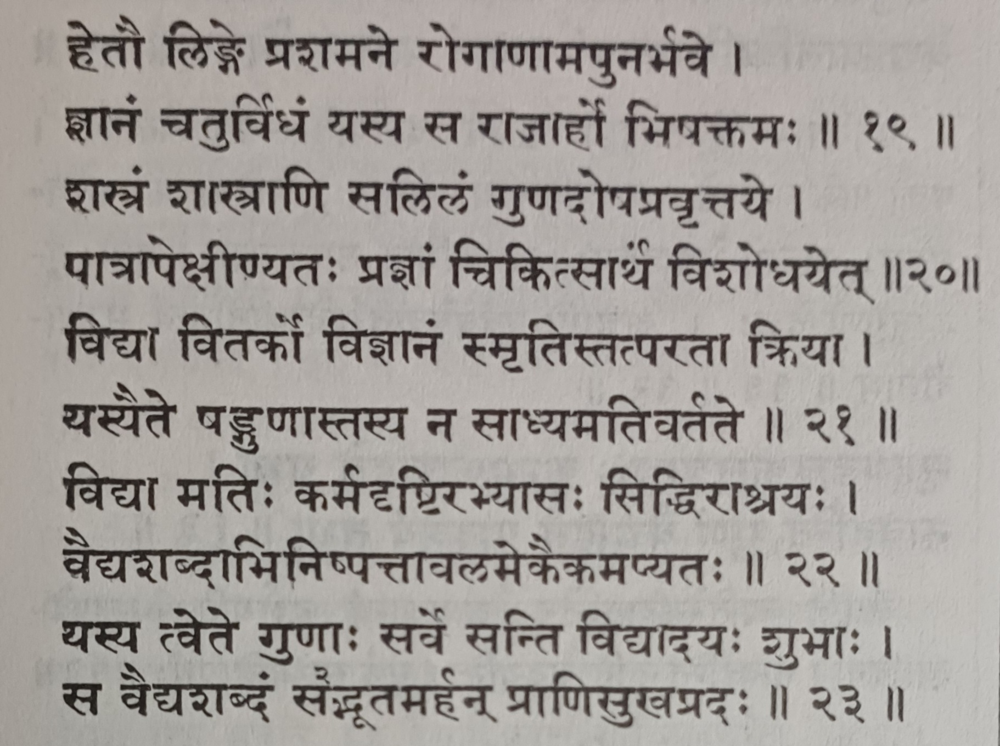
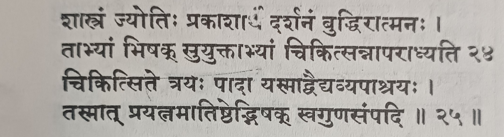
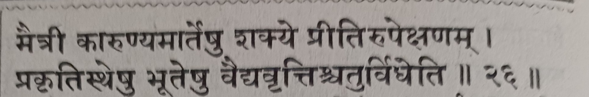

**The Light and the Eye: What Caraka Says a Physician Needs, and Why It Must Be Taught on Day One**

*MD (Ayu-Shalya), PGDMLS, MS (Counseling & Psychotherapy) | Academician, Clinician & Researcher | Chief Editor, International Journal of Ayurveda*

**Disclaimer:** The views expressed in this article are my personal opinions. They do not represent any institution with which I am or have been affiliated. This article is for educational discussion and is not medical advice. In the interest of transparency, this article was developed in collaboration with AI tools for research, structuring and drafting. The idea, the final views and the conclusions are my own.

In my last article, "The Goatherd Knows the Plant", I argued that we teach BAMS students at the bottom rung of Caraka's ladder, and that thinking like a vaidya should begin on the first day. A fair question followed: begin with what? What, exactly, would I teach in the first week?

Caraka answers that question himself. In Sutra Sthana chapter 9, the Khuddaka Catushpada, there is a short passage (verses 20 to 26 in the edition I use; please check your own) that reads like a minimum specification for a physician. It lists qualities, sources of competence and attitudes. It tells us what the physician is made of. And it never says, "learn these later".

This article walks through those verses, quality by quality, from two sides: what Caraka means, and why a modern clinician would recognise the same thing. My translations are paraphrases, and the interpretive choices are flagged as mine. Commentators differ on several terms, and you should read them.

## **The verses at a glance**

| **Verse** | **Key terms** | **The point, in brief** |
| --- | --- | --- |
| 20 | *shastra*, *shastrani*, *salila*, *prajna* | A weapon, the scriptures and water show their merit or harm according to the one who holds them. So the physician must keep purifying his intellect. |
| 21 | *vidya*, *vitarka*, *vijnana*, *smriti*, *tatparata*, *kriya* | Six qualities. One who has them does not let the curable slip past. |
| 22-23 | *vidya*, *mati*, *karma-drishti*, *abhyasa*, *siddhi*, *ashraya* | Six supports of competence. Any one is enough to justify the word vaidya. One who has all of them is truly a vaidya, a giver of happiness to living beings. |
| 24 | *shastra* as light, *buddhi* as the eye | Text is the light, one's own intellect is the eye. With both, the physician does not err. |
| 25 | three pillars depend on the physician | The other three of the four pillars of treatment depend on the physician, so he must strive to enrich his own qualities. |
| 26 | *maitri*, *karunya*, *priti*, *upeksha* | Four attitudes of the physician towards different kinds of persons. |

## **Verse 20: The weapon, the scripture and the water**

Caraka begins with three images. A weapon can protect or kill. Scriptures can enlighten or mislead. Water can nourish or drown. In each case the thing is neither good nor bad on its own. Its effect depends on the person who holds it. Therefore, he says, the physician should keep purifying his *prajna*, his intellect, for the sake of treatment.

I read this as the opening principle of the whole passage. Notice that Caraka does not say, "study the scriptures, and all will be well". He says the scripture itself is only as safe as the mind that uses it. That should alarm every teacher who believes that finishing the syllabus produces a physician.

**The modern parallel.** Every powerful tool in medicine has this nature: a scalpel, a steroid, an antibiotic, a clinical guideline, and now an AI chatbot. None of them has judgement. The user does. This is why medical education today talks not only about knowledge but about competence, judgement and professionalism. As a surgeon I can add that the same instrument heals or harms depending on who holds it and whether they know when to put it down.

**What I would do on day one.** Read verse 20 aloud with the new students and ask them one question: "What would it mean to purify your own intellect?" Let them struggle with it. The rest of the programme is the answer.

## **Verse 21: Six qualities of the one who does not miss the target**

The six terms are vidya, vitarka, vijnana, smriti, tatparata and kriya. The translation on my page renders them as knowledge, critical approach, insight into allied sciences, good memory, promptness and perseverance. Other readings are possible, especially for the last two. Let me take each in turn.

### ***Vidya: knowledge***

**In Ayurveda.** Learning of the science: the texts, the concepts, the language in which they are written. It is the base of the ladder in my previous article, and it is not despised. Caraka lists it first.

**In modern terms.** The foundational knowledge of a discipline. Every medical curriculum begins here. But modern medicine adds a warning that Caraka would have understood: knowledge keeps changing, and a physician who stops learning slowly becomes a physician of the past.

**Why it matters.** Without it nothing else can stand. With only this, one remains on the first rungs. **Day one:** teach students to read the primary text in the first week, not only notes and guides.

### ***Vitarka: critical thinking***

**In Ayurveda.** *Tarka* and *vitarka* belong to the reasoning traditions of Indian philosophy, where reasoning is used to test a claim, to examine alternatives and to avoid wrong conclusions. The translation on my page says "critical approach", and I find that apt, though scholars discuss the precise senses of the term.

**In modern terms.** Critical appraisal, differential diagnosis, hypothesis testing, asking "what else could explain this?" Research on diagnostic error repeatedly finds that cognitive biases, such as settling too early on a first impression, contribute to mistakes. Training in critical thinking is not a luxury.

**Why it matters.** It is the difference between recalling that a drug is used for a condition and understanding why it might work in this patient. **Day one:** teach three questions for every claim: how do we know, compared with what, and what would show it is wrong?

### ***Vijnana: discernment and insight into allied sciences***

**In Ayurveda.** The translation I use reads this as insight into allied sciences. In my reading it means a deeper, applied and connected understanding, the ability to see how one body of knowledge bears on another, rather than a set of separate subjects.

**In modern terms.** Integration across basic sciences, clinical subjects and, increasingly, statistics, pharmacology, public health and technology. Medicine is no longer practised from a single textbook.

**Why it matters.** Patients do not arrive divided into subjects. **Day one:** from the first week, show students how subjects connect. Ask one cross-subject question each week: how does what we learned in Rachana Sharir help us understand this symptom in Roga Nidan?

### ***Smriti: memory***

**In Ayurveda.** Retention and recall of what has been learned. Texts were once carried in memory, and good memory remains a virtue.

**In modern terms.** Memory remains essential for fluency and speed. But it is also fallible and biased, and modern practice supports it with records, checklists and references. A good physician remembers well, and also knows when to check.

**Why it matters.** Memory that holds the principles lets you reason quickly. Memory that holds only lists lets you recite. **Day one:** teach how to remember: spaced revision, testing yourself without the book, and keeping notes you can search.

### ***Tatparata: dedication and promptness***

**In Ayurveda.** The translation says promptness and perseverance. I read it as being fully committed to the task, attentive, and not distracted.

**In modern terms.** Professionalism, diligence, timeliness and attention. Patient safety research shows that lapses of attention and haste cause harm.

**Why it matters.** Most errors in practice are not errors of ignorance. They are lapses of attention. **Day one:** treat punctuality, attention and finishing what one starts as skills to be practised, not as moral lectures.

### ***Kriya: practice and skilful action***

**In Ayurveda.** The performance of treatment itself: the actual doing. The classical word for therapy, *chikitsa*, is a practical art.

**In modern terms.** Clinical and procedural skills. A useful model in medical education, Miller's pyramid, climbs from "knows" to "knows how", "shows how" and finally "does". The top is doing.

**Why it matters.** A physician who knows but cannot do has not completed the task. **Day one:** give students hands-on skills in the first month: taking a pulse, measuring blood pressure, basic life support, simple history-taking with role play.

Caraka says that one who has all six does not let the curable go beyond his reach. Look at that list again. Only the first and the fourth are about content. The other four are about thinking, connecting, attending and doing. Our first year is largely about the first and the fourth.

## **Verses 22 and 23: Six supports of the name vaidya**

Verse 22 gives a second list: vidya, mati, karma-drishti, abhyasa, siddhi and ashraya. In my reading, verse 21 describes qualities in the person, while verse 22 describes the kinds of grounding that make a physician worthy of the name: learning, intelligence, seeing practice, repeated practice, success in treatment and reliance on a teacher. Caraka then says something striking: *any one of these is enough* to justify the word vaidya, and the one who has all of them truly deserves the name and gives happiness to living beings.

I read this as a generous and sobering statement together. The word vaidya is easily earned in part. It is deserved only in full. That fits the ladder: the title may be worn at the lower rungs, but the work is done at the top.

Vidya we have met. Let me take the other five.

### ***Mati: intelligence and reasoning***

**In Ayurveda.** The faculty of understanding and discriminating. **In modern terms.** Clinical reasoning. Cognitive science describes two modes: fast, intuitive recognition and slow, analytical reasoning. Good clinicians know when to trust the first and when to switch to the second. **Day one:** use short case puzzles in the first week and ask students to say their reasoning aloud.

### ***Karma-drishti: seeing the work being done***

**In Ayurveda.** Practical experience, literally seeing action. In a tradition of apprenticeship, one learns by watching an expert at work. **In modern terms.** Clinical exposure and observation, the foundation of every apprenticeship model of medicine. **Day one:** do not keep students away from patients until the third year. Take them to the OPD in the first month, with a simple observation sheet: what did you see, what did you hear, what puzzled you?

### ***Abhyasa: repeated practice***

**In Ayurveda.** Continued practice, doing it again and again. **In modern terms.** Research on expertise emphasises deliberate practice: repetition with feedback and a goal of improvement, not mere repetition. **Day one:** build a daily habit: ten minutes of Sanskrit, one passage of a text, a short written summary. Small and daily beats large and occasional.

### ***Siddhi: success in treatment***

**In Ayurveda.** Accomplishment, a successful outcome. This is the rung of the ladder that my earlier article placed at the top. **In modern terms.** Outcomes, audit and feedback. A physician who never reviews outcomes cannot learn from them. And recall the warning of Sutra Sthana 1/134-135: success must be explained, not merely enjoyed. **Day one:** teach students to start a case diary and to ask, for every case, why the patient improved or did not.

### ***Ashraya: reliance on an experienced teacher***

**In Ayurveda.** Dependence on a skilled preceptor. The tradition did not imagine a physician made without a teacher. **In modern terms.** Mentorship, supervision and feedback. A physician who has no one to correct him is in danger of becoming his own authority. **Day one:** give every student a mentor in the first week, not the third year. Teach them also how to ask for feedback and how to receive it.

## **Verse 24: The light and the eye**

This is the most beautiful verse in the passage. The scripture (*shastra*) is a light that illuminates. One's own intellect (*buddhi*) is the eye. A physician well joined with both does not err in treatment. Light without an eye shows nothing to a person who cannot see. An eye without light sees nothing in the dark.

**The modern parallel.** Modern medicine has a close counterpart. Evidence-based practice is usually described as the integration of the best available evidence, the clinician's own expertise and judgement, and the patient's values. The evidence is the light. The clinician's judgement is the eye. Teaching one without the other has failed medicine in both traditions. A guideline followed without thought causes harm. Intuition without evidence is merely confidence.

**Why it matters for teaching.** If we give students only the light, we make people who can recite. If we only praise their own opinion, we make people who are certain. Caraka wants both from the beginning. **Day one:** after every lecture, ask a student to name what the text says and what they think about it. Keep the two separate.

## **Verse 25: The three pillars depend on you**

The Khuddaka Catushpada names four pillars of treatment: the physician, the medicine, the attendant and the patient. Verse 25 says that the other three depend on the physician. Therefore, Caraka says, the physician must exert himself to enrich his own qualities. Verse 27, on the same page, says that the physician is the most important of the four, because of the qualities he holds.

This is a high bar and a heavy responsibility. It also expresses a principle that modern quality-of-care research would accept in some form: the best drug, the best hospital and the best nursing care can be defeated by a poorly trained or careless clinician, and can be redeemed by a good one.

**Why it matters for teaching.** It says that the training of the physician is the training of the whole treatment. A college that invests in buildings and neglects the cultivation of the physician has misunderstood Caraka.

## **Verse 26: Four attitudes**

The last verse in the passage is about heart, not head. It lists four attitudes of the physician: *maitri* (friendliness), *karunya* (compassion), *priti* (joyful commitment) and *upeksha* (equanimity or detachment). Different persons call for different attitudes: friendliness to those who are well, compassion for the sick, committed effort for those who can be cured, and equanimity where cure is not possible.

| **Attitude** | **Directed towards, in my reading** |
| --- | --- |
| **Maitri** (friendliness) | Those who are well, and in a broader sense all persons |
| **Karunya** (compassion) | The sick |
| **Priti** (joyful commitment) | Those who can be cured |
| **Upeksha** (equanimity) | Those for whom cure is not possible |

**Note on translation.** The translation on the page I am using renders this more loosely: kindness to all patients, concern for those who are likely to be cured, and detachment from those who are towards death. Commentators and translators differ on exactly who the first attitude is meant for, so please check the verse and a commentary rather than relying on my paraphrase.

**The modern parallel.** Professionalism, empathy, and what the literature calls detached concern: caring deeply while keeping the emotional balance needed to act well. Palliative care is the clearest modern expression of the last attitude. And I must add an important caution. *Upeksha* is not abandonment. In modern practice, "nothing more can be done" is never true. There is always comfort, honesty, dignity and the family. Equanimity is what allows a physician to remain present at the bedside of a dying person without collapsing or fleeing.

**Why it matters.** Technical skill without these attitudes produces competent strangers. **Day one:** introduce the four attitudes as skills to be practised: how to greet, how to listen, how to deliver bad news, how to stay steady. Role play helps.

## **What we do instead**

Look at the passage as a whole and then at a typical first year. Verse 21 asks for knowledge, critical thinking, integration, memory, dedication and practice. We give lectures for the first and the fourth. Verse 22 asks for learning, reasoning, observation of practice, repetition, success and a teacher. We give lectures and an examination. Verse 24 asks for light and an eye. We give light, a great deal of it, and very little training of the eye. Verse 26 asks for four attitudes. We rarely give them a lesson.

Then we are surprised when graduates cannot reason, cannot examine, cannot read a paper and cannot say "I do not know".

If these verses are the minimum, then a curriculum that postpones them has lost the opportunity. A habit of critical thinking is not built in the final year. It is built, or not built, in the first month.

## **A first week, in outline**

- **Day 1:** read verses 20 to 26 together, aloud, with the Sanskrit. Ask: which of these do I have, and which will I build?
- **Day 2:** the three questions: how do we know, compared with what, and what would show this is wrong? Practise on a claim from daily life.
- **Day 3:** observe a real OPD, with an observation sheet. Write what you saw, heard and wondered.
- **Day 4:** a memory and notes workshop: spaced revision, self-testing, a notebook that can be searched and backed up.
- **Day 5:** a first hands-on skill, and a role play of listening to a patient.
- **Every day:** ten minutes of Sanskrit, one passage of the text, one question for a teacher.
- **Throughout:** a mentor for every student, and a self-assessment at the end of the month.

None of this needs a new curriculum notified by a regulator. It needs a teacher who believes that these verses were meant to be used.

## **A closing thought**

Caraka says the physician should keep purifying his intellect. Not once, at graduation, but continually. The verse has been with us for two thousand years or more. Perhaps the question is not whether we have read it, but whether we have taught it, and whether we have been willing to begin where it begins.

If the first year is where the habits of a lifetime form, then these seven verses are the syllabus we have been missing.

I would like to hear from other teachers: what would you add to the first week?

---

*Share your thoughts in the comments below.*
